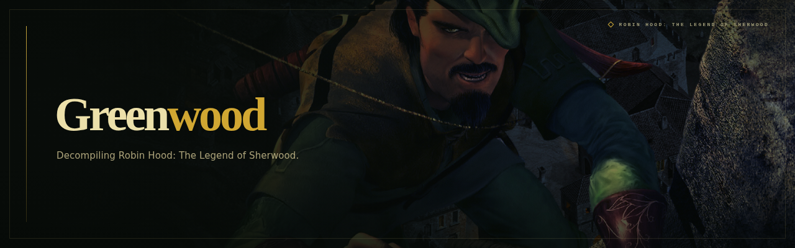
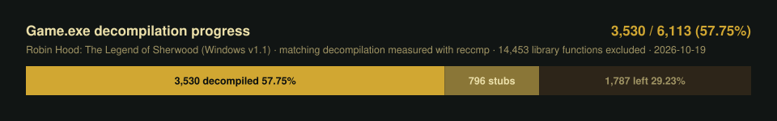

## Status

## About

Greenwood aims to fully decompile **Robin Hood: The Legend of Sherwood** (2002, Spellbound Entertainment), targeting **v1.1**. The goal is C++ source that compiles with **Microsoft Visual C++ 6.0 SP6** into byte-identical machine code, not a replacement engine or port.

## Credits

- [reccmp](https://github.com/isledecomp/reccmp) - compiled-function comparison and matching progress.
- [Ghidra](https://github.com/NationalSecurityAgency/ghidra) - disassembly and decompilation.
- [radare2](https://github.com/radareorg/radare2) - binary inspection and analysis.
- [Wine](https://www.winehq.org/) - running the original Windows compiler on Linux.
- [MSVC600](https://github.com/itsmattkc/MSVC600) - portable Visual C++ 6.0 toolchain.
- [objdiff](https://github.com/encounter/objdiff) - secondary compiled-code comparison.
